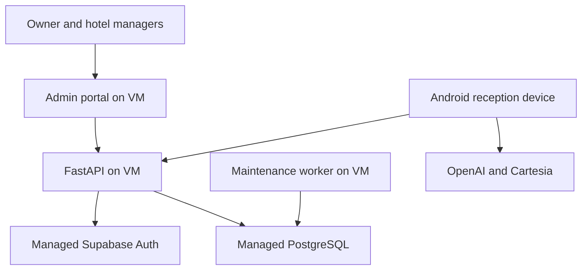

# V2 implementation candidate

Branch: `test-branch`. Git does not allow a space in `test branch`.
Android source candidate: **17.0.45 / 75**, package **dev.orange.hotel**.
This branch does not publish an APK or deploy a service.

## What is built

| Goal | Implementation | Evidence or remaining acceptance |
| --- | --- | --- |
| 1. Backend foundation | Isolated FastAPI control API, PostgreSQL models, frozen Alembic migration, health endpoints, bounded worker | Disposable migrations and transaction tests; actual VM/database qualification remains external |
| 2. Accounts and hotel permissions | Managed Supabase invitations/password/recovery, opaque browser sessions, owner MFA, current account/membership checks, owner/manager/operator/viewer permissions | Fake-identity API and real-browser fixtures; real SMTP/Auth configuration remains external |
| 3. Connect devices once | Android staff-gated pairing, separate encrypted device identity, activation, crash recovery, rotation and revocation | JVM storage/HTTPS/crash tests and real API/browser pairing; physical tablet and same-signer upgrade acceptance still required |
| 4. Real monitoring | Fresh ordered foreground heartbeats, bounded offline metadata events, scoped fleet/details and recorded measurements | Browser fixture reports through the actual API; no guest audio, captions, notes or keys uploaded |
| 5. Safe management | Versioned approved public hotel settings, desired/applied versions, safe commands, durable receipts, alerts and audit | Config/command/duplicate/expiry/role tests; native effects defer during audio ownership |
| 6. Reliability and privacy | Authorization, MFA/CSRF, idempotency, restart/lost-response, migration/RLS and regression checks; minimized telemetry | Native PostgreSQL lock checks run in CI; real backup restore, provider processing review and device acceptance remain production gates |
| 7. Pilot preparation | VM inspection, Caddy/container topology, separate migration/runtime secrets, deployment/rollback/smoke helpers, CI and rollout runbook | Prepared for an authorized operator; no cloud project, DNS, invitation, production mutation or hotel pilot performed |

The existing OpenAI translator, Cartesia receptionist, audio engine, reception
assets and local staff journal are retained. The new control service does not
mount the legacy master-token admin/voice application. Native fleet enrollment
does not overwrite `HotelConnection` or provider keys. It needs an Android
screen lock for staff authorization; guests do not sign in to reception.

Suhair's separate working checkout was not provided. This implementation uses
the canonical repository's existing app and adds the admin portal separately.
It does not claim to have integrated changes from an unavailable checkout.

## Runtime layout



Voice traffic stays direct. Cloud management stores hotel/device operations and
minimized health metadata. Private local memory is not synchronized by this PR.
The API is the privileged hotel authorization boundary; database Data API access
is denied. The runtime database role and tenant checks must both be qualified.

## Local verification

From the repository root, install `requirements-control-dev.txt`,
`requirements-browser.txt`, root npm dependencies, `tests/v2` dependencies and
`admin-v2` dependencies. The browser runner requires a built portal and Chromium.

```sh
.venv/bin/python -m pytest tests -q
node --test tests/*.test.cjs
node --test tests/v2/*.test.mjs
npm run check:reception
npm --prefix admin-v2 run typecheck
npm --prefix admin-v2 test
npm --prefix admin-v2 run build
.venv/bin/python -m playwright install chromium
.venv/bin/python tests/control/browser_smoke.py
```

Use normal Node test isolation; forcing unrelated legacy Google-verifier suites
into one isolate shares a fake-key cache and invalidates their fixture assumptions.

The real-browser smoke runner starts a disposable migrated SQLite database,
injects synthetic managed identities and exercises the built portal against the
actual HTTP API: owner login/MFA → hotel creation → device-code approval →
credential activation → fresh metadata → command receipts → configuration/ACK →
second-hotel denial → manager logout → device revocation. It makes no external
identity, email or model calls. Screenshots contain synthetic data only.

For native checks, from `android/`, with a configured SDK and Java17:

```sh
bash gradlew :hotel:testDebugUnitTest :hotel:lintDebug \
  :hotel:assembleDebug :hotel:assembleDebugAndroidTest --no-daemon
```

Source/JVM/build checks do not establish physical microphone quality, acoustic
latency, EMM relaunch or unattended Android installation eligibility.

PostgreSQL CI uses a disposable PostgreSQL16 service. The local fallback used
PostgreSQL18.6 through PGlite to validate upgrade → downgrade → upgrade, no
Alembic drift, Unicode/JSON/FK/rollback behavior, lifecycle storage boundaries
and default-deny RLS. The actual runtime-role SQL was also exercised: runtime
CRUD/readiness reads succeeded; public DDL and browser-role reads were denied.
Its connection multiplexer cannot qualify the two native
multi-connection lock tests. Those are explicitly skipped locally and required
against native PostgreSQL in CI.

Recorded local results for this candidate:

| Check | Result |
| --- | --- |
| Python regression suite | 290 passed; eight PostgreSQL cases skipped without the disposable DB environment |
| PostgreSQL/PGlite suite | Six passed; two native multi-connection cases skipped |
| Android JVM tests | 198 passed, including 29 new fleet tests |
| Android lint and debug/application-test APK assembly | Passed; no connected device runtime execution |
| Admin portal | 27 tests, typecheck and production build passed |
| Existing Node suites | 21 reception/retirement and 33 legacy V2 tests passed |
| Existing reception browser fixtures | Five passed in Chromium153 |
| New portal/API browser flow | Passed in Chromium153 with isolated synthetic data |
| Provider setup/benchmark helper fixtures | 13 and 15 passed; no provider requests |
| Container execution and real infrastructure | Not run locally; Docker unavailable and production access not supplied |

## Operational boundaries

- No new provider credential enters Git, the portal bundle or control images.
  The already authorized V1 credential policy is preserved; this management PR
  is not a migration of extractable keys in older release APKs. Revoking a fleet
  identity stops management access, not a provider call using an older APK key.
- Freshness is based on accepted ordered heartbeats, not late event uploads.
  A durable monotonic reporting generation prevents an unseen delayed old boot
  from retiring a current reporter. Timing names describe actual measurement
  boundaries; connectivity does not prove voice quality.
- Device details summarize fourteen days of received session/error reports.
  Timing summaries disclose sample counts and use at most the latest 1,000
  timing events. Missing or evicted local reports are not counted as complete
  hotel usage; delayed uploads are grouped by receipt time explicitly.
- Remote commands are limited to settings refresh, update discovery and
  sanitized diagnostics. They cannot run shell commands, upload private memory,
  select arbitrary URLs, record audio or assert an update was installed.
- The worker prunes diagnostic events after fourteen days in bounded batches.
  Audit/operational record retention, deletion approval, backup retention and
  support-access policy require an explicit operator decision before production.
- EU hosting is an infrastructure choice, not a compliance certification.
  Actual vendor processing locations, contracts, legal bases, notices and
  retention/deletion procedures remain production qualification work.

Deployment configuration, bootstrap steps, separate database-role setup,
backup/restore and rollback instructions: [v2-deployment.md](v2-deployment.md).
API details: [v2-contract.md](v2-contract.md).
